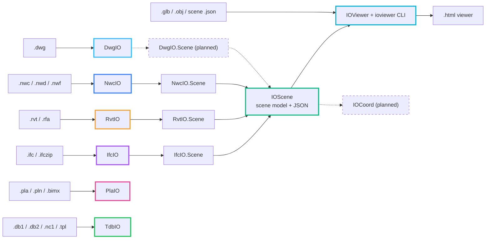

<div align="center">


# IOExtend

**Pure managed .NET libraries and cross-platform CLI tools for BIM and CAD interoperability.**

*Read, inspect, and convert building models and drawings without the authoring software, its API, or native libraries installed.*

---

[](https://github.com/IOExtend)
[](https://opensource.org/licenses/MIT)
[](https://dotnet.microsoft.com/)
[](https://github.com/IOExtend)

</div>

<br/>

## The Ecosystem

IOExtend is a set of independent .NET engines, each reading one family of BIM or CAD formats, plus a neutral scene model and a standalone HTML viewer. Everything is managed code without native libraries, for use in CI/CD pipelines, web backends, and desktop engineering software.

### Engines

| Project | Primary Formats | Key Capabilities | Documentation | NuGet | Release | Brand Palette |
|:---|:---|:---|:---:|:---:|:---:|:---:|
| **[RvtIO](https://github.com/IOExtend/RvtIO)** | `.rvt`, `.rfa` (Revit 2020–2026 tested, 2027 partial) | Elements, parameters, geometry, file metadata and project information, `FilteredElementCollector` queries, triangle meshes with one shared mesh per family symbol (`ElementMeshes`), IFC2X3 and JSON export; `RvtIO.Scene` turns a project into an IOScene scene. Reads only; does not write Revit files | [](https://ioextend.github.io/RvtIO/) | [](https://www.nuget.org/packages/RvtIO) | [](https://github.com/IOExtend/RvtIO/releases) | `Amber` `#F2A33A` |
| **[NwcIO](https://github.com/IOExtend/NwcIO)** | `.nwc`, `.nwd`, `.nwf` (Navisworks 2016–2026 tested) | Scene hierarchy, meshes, materials decoded from the file, element GUIDs and IFC GlobalIds, property tabs and properties; viewpoints and redlines; JSON export; writes `.nwc`; `NwcIO.Scene` turns a model file into an IOScene scene in metres with element GUIDs, IFC GlobalIds, property tabs and file materials. Scene trees with partition nodes (`.nwd`) and linked Revit models are not decoded. *Frozen, bug fixes only:* IFC2X3/IFC4, glTF, OBJ and HTML export, clash detection, grouping and matrix, HTML clash report, BCF 2.1, measure, grids, revision diff, TimeLiner, selection and search sets, appearance profiler, mesh clipper, Navisworks XML | [](https://ioextend.github.io/NwcIO/) | [](https://www.nuget.org/packages/NwcIO) | [](https://github.com/IOExtend/NwcIO/releases) | `Azure Blue` `#3B82F6` |
| **[IfcIO](https://github.com/IOExtend/IfcIO)** | `.ifc`, `.ifczip` | Reads and writes ISO 10303-21 STEP for buildingSMART IFC2x3 CV 2.0 and IFC4, spatial hierarchy, properties and meshes, `IfcApi` facade, 5D cost schedules, IDS 1.0 audit, JSON export; `IfcIO.Scene` converts a model into an IOScene scene. *Frozen, bug fixes only:* HTML viewer, glTF/OBJ export, clash, measure, grids, diff, BCF 2.1, 4D work-schedule logic | [](https://ioextend.github.io/IfcIO/) | [](https://www.nuget.org/packages/IfcIO) | [](https://github.com/IOExtend/IfcIO/releases) | `Electric Violet` `#A855F7` |
| **[DwgIO](https://github.com/IOExtend/DwgIO)** | `.dwg` (AutoCAD R2004, R2010, R2013, R2018) | Version detection (R13–R2018), section container and decompression, drawing metadata, thumbnail and handle map, LINE/CIRCLE/ARC/POINT geometry, JSON export. R13–R2000 and R2007 are planned | [](https://ioextend.github.io/DwgIO/) | [](https://www.nuget.org/packages/DwgIO) | [](https://github.com/IOExtend/DwgIO/releases) | `Sky Blue` `#38BDF8` |
| **[PlaIO](https://github.com/IOExtend/PlaIO)** | `.pla`, `.pln` (Archicad 27, 29, 30), `.bimx` cover | File kind detection, container header, `BL`/`DY` block index, raw and zero-mask payload decoding, object directory search, BIMx PNG cover, text reports and directory JSON. Preview: elements, parameters and geometry are not read | [](https://ioextend.github.io/PlaIO/) | [](https://www.nuget.org/packages/PlaIO) | [](https://github.com/IOExtend/PlaIO/releases) | `Pink` `#EC4899` |
| **[TdbIO](https://github.com/IOExtend/TdbIO)** | `.db1`, `.db2`, DBV@, `.nc1`, `.tpl`, `.rpt`, `.xsr` (Tekla Structures) | Kind detection from the content, gzip unpacking with size and CRC-32 checks, model database header, id map, text chains and save dates, table sections walked to the last byte with rows as raw bytes, id range and GUID map files, DSTV NC parts, template block trees, report pages, text or JSON output. Preview: rows are not decoded into parts, assemblies or other model objects, drawing files are only recognised, and nothing is written | [](https://ioextend.github.io/TdbIO/) | [](https://www.nuget.org/packages/TdbIO) | [](https://github.com/IOExtend/TdbIO/releases) | `Green` `#22C55E` |

### Scene model and viewer

| Project | Primary Formats | Key Capabilities | Documentation | NuGet | Release | Brand Palette |
|:---|:---|:---|:---:|:---:|:---:|:---:|
| **[IOScene](https://github.com/IOExtend/IOScene)** | Scene `.json` (`"Kind": "ioscene"`) | Neutral scene model for tessellated BIM and CAD data: elements, instanced geometry, materials, typed properties, models, levels, grids, viewpoints, 4D schedules, clash results. Metres, right-handed, Z up. `SceneJson` reader/writer and `Validate()`. No dependencies. Stable from 0.1.0: a patch adds or fixes, a breaking change waits for 0.2.0 | [](https://github.com/IOExtend/IOScene/blob/main/docs/contract.md) | [](https://www.nuget.org/packages/IOScene) | [](https://github.com/IOExtend/IOScene/releases) | `Emerald` `#10B981` |
| **[IOViewer](https://github.com/IOExtend/IOViewer)** | `.glb`, `.obj`, JSON; `.ifc`, `.ifczip`, `.rvt` with the tool → `.html` | One self-contained HTML file that works offline (three.js embedded): model tree and properties, view cube, up to six section planes or a section box, distance measurement, viewpoints and tour, clash results, 4D schedule player, Russian and English interface. Built on IOScene from 0.3.0; the `ioviewer` tool reads IFC and Revit files through `IfcIO.Scene` and `RvtIO.Scene`. It does not read `.nwc` files: a Navisworks model comes in as an IOScene scene `.json` written with `NwcIO.Scene` | [](https://ioextend.github.io/IOViewer/) | [](https://www.nuget.org/packages/IOViewer) | [](https://github.com/IOExtend/IOViewer/releases) | `Cyan` `#06B6D4` |

---

## Architecture

- **Engines are leaves.** RvtIO, NwcIO, IfcIO, DwgIO, PlaIO, and TdbIO each read their own format, and some also write it. No engine references another IOExtend package or a scene type.
- **IOScene is the neutral contract.** A scene holds what a viewer or coordination tool shows, filters, measures, or tests. It is not an authoring model, and no source file is rebuilt from it.
- **Adapters live with their engine.** `<Engine>.Scene` turns an engine's model into an IOScene `SceneDocument`. It ships on the engine's version and tag, depends on exactly that engine version, and uses only the engine's public API.
- **Consumers depend on IOScene only.** From 0.3.0 the IOViewer library references IOScene and no engine. Only command line tools combine several adapters.
- **Frozen extras.** Viewer, export, and coordination features inside IfcIO and NwcIO get bug fixes only. They stay available and are removed no earlier than that engine's 1.0, and only after a published replacement exists.



Solid arrows are code that exists; dashed arrows are planned. PlaIO and TdbIO have no scene adapter.

| Piece | Status |
|:---|:---|
| IOScene | 0.1.1 on NuGet, a patch of 0.1.0, the first stable release |
| IfcIO.Scene, RvtIO.Scene, NwcIO.Scene | On NuGet with their engines: `IfcIO.Scene` 0.11.1, `RvtIO.Scene` 0.4.0 and `NwcIO.Scene` 0.12.0 (IfcIO 0.11.0 shipped without its adapter) |
| IOViewer on IOScene | 0.3.1 on NuGet; 0.3.0 was a breaking API change from 0.2.0 |
| `ioviewer` with `.ifc`, `.ifczip`, `.rvt` input | In `IOViewer.Cli` from 0.3.0; an error of the engine gives exit code 4 after the output is written, and from 0.3.1 a `--serve` preview server that fails gives exit code 5 |
| Navisworks models in IOViewer | Through an IOScene scene `.json` written with `NwcIO.Scene`; `ioviewer` does not read `.nwc` files |
| DwgIO.Scene | Planned |
| IOScene.Formats | Planned: GLB/OBJ readers and a GLB writer over IOScene |
| IOCoord | Planned: clash, measure, grids, diff, and BCF over IOScene |

A Revit or IFC model becomes a viewer in one step: `ioviewer project.rvt -o viewer.html` (or `model.ifc`). A Navisworks model takes two: `NwcSceneReader.Read` and `SceneJson.Save` write a scene file in code, and `ioviewer model.scene.json -o viewer.html` turns it into a page.

**Versioning.** In 0.x a patch release adds or fixes and a minor release may break. A dependent references one IOScene line as `[0.N.0, 0.N+1.0-0.0)` (nuget.org refuses the shorter bound `-0` in a dependency), and an adapter pins its engine as `[X.Y.Z]`. Releases go in order: IOScene, then the engines with their adapters, then IOViewer.

---

## Architectural Principles

1. **Pure Managed .NET**:
   - No C/C++ native libraries (`.dll`, `.so`, `.dylib`).
   - Targets .NET 8 and .NET 10; the engine and viewer READMEs list Windows, Linux, and macOS as supported, except TdbIO's, which states that it uses no Windows-only APIs and whose CI runs on all three.
2. **No Proprietary SDK Dependencies**:
   - Works without Autodesk Revit, Autodesk Navisworks, AutoCAD, Archicad, Tekla Structures, or their APIs.
3. **Clean-Room Specification**:
   - Written independently from format analysis, ISO/buildingSMART standards, and documented specifications.
   - No decompiled or leaked source, no vendor headers or SDKs. The few open-source components, such as OpenMcdf and SharpZipLib in RvtIO and three.js in IOViewer pages, are listed in that repository's `THIRD-PARTY-NOTICES.md`.
4. **Stated Scope**:
   - Each README states the tested version range and what is not read or written; IfcIO and NwcIO also list their frozen features.

---

## Quick Start

### Installation

Install any of the libraries via the .NET CLI:

```bash
# Autodesk Revit engine
dotnet add package RvtIO

# Autodesk Navisworks engine
dotnet add package NwcIO

# buildingSMART IFC engine
dotnet add package IfcIO

# Autodesk DWG engine
dotnet add package DwgIO

# Archicad project container reader
dotnet add package PlaIO

# Tekla Structures file reader
dotnet add package TdbIO

# Neutral scene model
dotnet add package IOScene

# Scene adapters: an engine's model as an IOScene scene
dotnet add package IfcIO.Scene
dotnet add package RvtIO.Scene
dotnet add package NwcIO.Scene

# Standalone WebGL/HTML viewer generator
dotnet add package IOViewer
```

### Global CLI Tools

Every engine and the viewer ship a command line tool for CI/CD scripting; IOScene is a library only:

```bash
# Install the CLI tools globally
dotnet tool install --global RvtIO.Cli
dotnet tool install --global NwcIO.Cli
dotnet tool install --global IfcIO.Cli
dotnet tool install --global DwgIO.Cli
dotnet tool install --global PlaIO.Cli
dotnet tool install --global TdbIO.Cli
dotnet tool install --global IOViewer.Cli

# Export a Revit project to IFC
rvtio project.rvt project.ifc

# Convert a Navisworks model to binary glTF
nwcio model.nwc model.glb

# Run clash detection over a folder of Navisworks models with BCF output
nwcio ./models --clash-bcf clashes.bcfzip --clash-tolerance 0.01

# Inspect an IFC model
ifcio info Building.ifc --report

# Inspect a DWG drawing
dwgio inspect drawing.dwg

# Inspect an Archicad project file
plaio info project.pln

# Inspect a Tekla Structures model database
tdbio info model.db1

# Generate a standalone HTML viewer from a GLB model
ioviewer model.glb -o viewer.html

# Or straight from a Revit or IFC model, read through RvtIO.Scene and IfcIO.Scene
ioviewer project.rvt -o viewer.html
```

---

## Security & Clean-Room Governance

- All repositories in the **IOExtend** organization follow a clean-room policy.
- Repositories contain **no confidential customer models, vendor files, or proprietary binaries**.
- Tests that need real model files (RvtIO, NwcIO, DwgIO, PlaIO, TdbIO) read them from a local folder named by a `*_TEST_FILES` environment variable. CI does not set it, so those tests are skipped there.
- Every public code repository has a `SECURITY.md`. Report vulnerabilities through GitHub private vulnerability reporting (the repository's **Security** tab, **Report a vulnerability**). Please do not open a public issue for a security problem.

---

<div align="center">
  <sub>Each project is released under the MIT License; see the LICENSE file in its repository. Trademarks belong to their respective owners.</sub>
</div>
