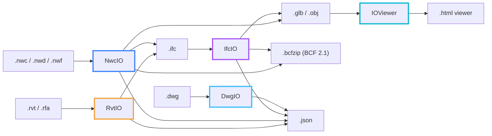

<div align="center">


# IOExtend

**High-performance, pure managed .NET libraries and cross-platform CLI tools for BIM and CAD interoperability.**

*Read, analyze, convert, and federate complex building models without proprietary runtime licenses, native wrappers, or CAD software installed.*

---

[](https://github.com/IOExtend)
[](https://opensource.org/licenses/MIT)
[](https://dotnet.microsoft.com/)
[](https://github.com/IOExtend)

</div>

<br/>

## The Ecosystem

IOExtend provides a unified suite of independent, zero-dependency .NET engines and viewer tools designed for high-throughput cloud microservices, CI/CD pipelines, web backends, and desktop engineering software.

| Project | Primary Formats | Key Capabilities | Documentation | NuGet | Release | Brand Palette |
|:---|:---|:---|:---:|:---:|:---:|:---:|
| **[RvtIO](https://github.com/IOExtend/RvtIO)** | `.rvt`, `.rfa` (Revit 2020–2026, 2027 partial) | Elements, parameters, geometry, file metadata and project information, `FilteredElementCollector` queries, IFC2X3 and JSON export | [](https://ioextend.github.io/RvtIO/) | [](https://www.nuget.org/packages/RvtIO) | [](https://github.com/IOExtend/RvtIO/releases) | `Amber` `#F2A33A` |
| **[NwcIO](https://github.com/IOExtend/NwcIO)** | `.nwc`, `.nwd`, `.nwf` | Navisworks binary `LcUStream` parser, scene hierarchy and meshes, clash detection and clash matrix, BCF 2.1, 4D TimeLiner, IFC2X3/IFC4, glTF, OBJ, HTML and JSON export | [](https://ioextend.github.io/NwcIO/) | [](https://www.nuget.org/packages/NwcIO) | [](https://github.com/IOExtend/NwcIO/releases) | `Azure Blue` `#3B82F6` |
| **[IfcIO](https://github.com/IOExtend/IfcIO)** | `.ifc`, `.ifczip` | Pure managed ISO 10303-21 STEP engine for buildingSMART IFC2x3 & IFC4, tessellated geometry, glTF/OBJ export, 4D/5D schedules, IDS audit, clash detection, BCF 2.1 | [](https://ioextend.github.io/IfcIO/) | [](https://www.nuget.org/packages/IfcIO) | [](https://github.com/IOExtend/IfcIO/releases) | `Electric Violet` `#A855F7` |
| **[DwgIO](https://github.com/IOExtend/DwgIO)** | `.dwg` (AutoCAD R2004–R2018) | DWG version detection (R13–R2018), section container and decompression, drawing metadata and thumbnail, LINE/CIRCLE/ARC/POINT geometry, JSON export | [](https://ioextend.github.io/DwgIO/) | [](https://www.nuget.org/packages/DwgIO) | [](https://github.com/IOExtend/DwgIO/releases) | `Sky Blue` `#38BDF8` |
| **[IOViewer](https://github.com/IOExtend/IOViewer)** | `.glb`, `.obj`, JSON → `.html` | Standalone single-file WebGL/HTML viewer: ViewCube, section planes and section box, BIM property tree, measurement, 4D TimeLiner player, clash inspection | [](https://ioextend.github.io/IOViewer/) | [](https://www.nuget.org/packages/IOViewer) | [](https://github.com/IOExtend/IOViewer/releases) | `Cyan` `#06B6D4` |

### How the pieces fit together

Each engine reads a native format and writes open formats that the other tools consume. For example, a Revit model can go `.rvt` → RvtIO → `.ifc` → IfcIO → `.glb` → IOViewer → `.html`.



---

## Architectural Principles

1. **100% Pure Managed .NET**:
   - Zero C/C++ native dynamic libraries (`.dll`, `.so`, `.dylib`).
   - Runs seamlessly inside minimal Alpine Linux Docker containers, AWS Lambda, Azure Functions, macOS ARM64/x64, and Windows.
2. **Zero Proprietary SDK Dependencies**:
   - Operates completely standalone without Autodesk Revit, Autodesk Navisworks, AutoCAD, or closed-source license daemons.
3. **Clean-Room Specification**:
   - All engines are authored from scratch using first-principles format analysis, official ISO/buildingSMART standards, and documented specifications.
   - Zero copyrighted code, zero decompiled source, and zero vendor header files.
4. **Extreme Performance**:
   - Streaming zlib and Deflate decompression without memory spikes.
   - Sub-second parsing of multi-hundred megabyte models with tens of thousands of geometry meshes.

---

## Quick Start

### Installation

Install any of the libraries via the .NET CLI:

```bash
# Autodesk Revit engine
dotnet add package RvtIO

# Autodesk Navisworks engine
dotnet add package NwcIO

# buildingSMART IFC engine
dotnet add package IfcIO

# Autodesk DWG engine
dotnet add package DwgIO

# Standalone WebGL/HTML viewer generator
dotnet add package IOViewer
```

### Global CLI Tools

Every project ships a command-line tool for CI/CD scripting:

```bash
# Install the CLI tools globally
dotnet tool install --global RvtIO.Cli
dotnet tool install --global NwcIO.Cli
dotnet tool install --global IfcIO.Cli
dotnet tool install --global DwgIO.Cli
dotnet tool install --global IOViewer.Cli

# Export a Revit project to IFC
rvtio project.rvt project.ifc

# Convert a Navisworks model to binary glTF and run clash detection with BCF output
nwcio model.nwc model.glb
nwcio clash arch.nwc mep.nwc --bcf clashes.bcfzip --tolerance 0.01

# Inspect an IFC model
ifcio info Building.ifc --report

# Inspect a DWG drawing
dwgio inspect drawing.dwg

# Generate a standalone HTML viewer from a GLB model
ioviewer model.glb -o viewer.html
```

---

## Security & Clean-Room Governance

- All repositories in the **IOExtend** organization strictly enforce clean-room policies.
- Repositories contain **no confidential customer models, vendor files, or proprietary binaries**.
- Automated CI workflows test against procedural synthetic data and isolated local environment fixtures (`*_TEST_FILES`).
- For security inquiries, please review the `SECURITY.md` file in each repository.

---

<div align="center">
  <sub>Copyright &copy; 2026 IOExtend. All rights reserved. Trademarks belong to their respective owners.</sub>
</div>
